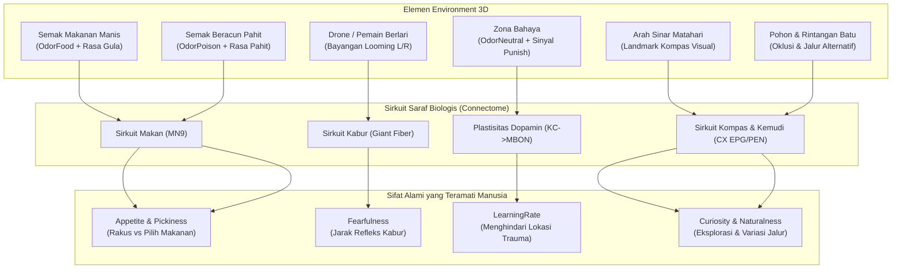

# Desain Environment & Pengujian Sifat Alami NPC Connectome

## Ringkasan Tujuan
Untuk memverifikasi bahwa **perilaku NPC benar-benar muncul secara alami dari sirkuit saraf biologis (connectome lalat) dan bukan sekadar animasi acak atau aturan kaku**, lingkungan 3D (*environment*) tidak boleh sekadar berupa kotak kosong.

Lingkungan harus dirancang sebagai **Laboratorium Ekologi Terbuka (Ecological Testing Arena)** yang menyediakan rangsangan sensorik spesifik bagi sirkuit saraf biologis:
- **Sensor Visual Looming** (LPLC2, LC4 &rarr; Giant Fiber / DNp)
- **Sensor Pengecap GRN** (Gula manis vs Pahit &rarr; Motor neuron belalai MN9)
- **Sensor Penciuman ORN/ALPN** (Aroma makanan, aroma racun, aroma netral &rarr; Mushroom Body)
- **Sensor Navigasi & Kompas Internal** (Cahaya matahari & landmark &rarr; Sirkuit Central Complex EPG/PEN/Ring Neurons)
- **Sensor Rasa Sakit & Penguat Dopamin** (Sengatan bahaya &rarr; Dopamin burst plastisitas KC&rarr;MBON)

Dokumen ini merinci **elemen apa saja yang wajib ada di environment**, **pembagian zona eksperimen**, serta **bagaimana mata manusia dapat mengamati sifat alami tersebut secara visual dan kuantitatif**.

---

## User Review Required

> [!IMPORTANT]
> **Struktur 4 Zona Eksperimen dalam Satu Arena Terpadu:**
> Kami mengusulkan membagi arena $40 \times 40\text{ m}$ menjadi 4 kuadran terencana yang memanfaatkan aset 3D yang baru saja diimpor:
> 1. **Kuadran 1: Kebun Makanan & Racun (*Feeding & Taste Discrimination Zone*)**
>    - Berisi semak buah manis (`Bush_Large_Flowers.gltf`) bersebelahan dengan semak beracun (`Bush_Small.gltf`).
>    - **Tujuan Uji**: Menguji sifat `Appetite` (nafsu makan) dan `Pickiness` (ketelitian rasa).
> 2. **Kuadran 2: Suaka Bahaya Terkondisi (*Aversive Learning Sanctuary*)**
>    - Berisi area tanah tandus berpohon kering (`DeadTree_*.gltf`) dengan kabut aroma netral + pemicu rasa sakit (*Punish*).
>    - **Tujuan Uji**: Menguji `LearningRate` (pembelajaran asosiatif memori dopamin: NPC tersengat sekali, lalu otomatis menghindar pada kunjungan berikutnya).
> 3. **Kuadran 3: Koridor Predator (*Looming Escape Runway*)**
>    - Area terbuka tempat Drone predator melayang menukik, atau pemain dapat berlari cepat (*sprint*) ke arah NPC.
>    - **Tujuan Uji**: Menguji `Fearfulness` (refleks kabur Giant Fiber saat ada bayangan membesar di mata).
> 4. **Kuadran 4: Labirin Hutan Navigasi (*Landmark Navigation & Natural Dispersion*)**
>    - Area rindang berpohon maple (`MapleTree_*.gltf`) dan formasi bebatuan alami di bawah sinar matahari bersudut.
>    - **Tujuan Uji**: Menguji `Curiosity` (dorongan jelajah) dan `NeuralNoise` (kelenturan rute alami vs pergerakan kaku garis lurus).

---

## Open Questions

> [!NOTE]
> 1. Apakah Anda ingin transisi antar zona dibiarkan terbuka (tanpa pagar pembatas) sehingga NPC bebas bermigrasi antar kuadran, atau diberi sekat rintangan alami (batu/pohon) dengan celah jalan masuk?
> 2. Apakah Anda menginginkan visualisasi aroma (*odor plumes*) berupa cincin lingkaran transparan di lantai atau partikel kabut berwarna lembut?

---

## Rincian Elemen Environment & Sifat Alami yang Diuji



---

### 1. Rincian Elemen Dunia yang Dibutuhkan

| Komponen Dunia | Representasi Aset 3D Baru | Input Sensor yang Dikirim ke Otak | Perilaku Nyata yang Diharapkan |
|---|---|---|---|
| **Makanan Manis** | `Bush_Large_Flowers.gltf` + Partikel Hijau/Oranye | `OdorFood` (penciuman) & `Sugar` (pengecap) | NPC lapar mencium bau &rarr; mendekat &rarr; proboscis MN9 aktif &rarr; makan sampai kenyang. |
| **Racun Pahit** | `Bush_Small.gltf` + Cincin Ungu | `OdorPoison` (penciuman) & `Bitter` (pengecap) | Rasa pahit menekan MN9. Hewan pemilih langsung mundur dan menggelengkan kepala. |
| **Zona Bahaya** | `DeadTree_*.gltf` + Kabut Merah/Tanah Retak | `OdorNeutral` (bau tanah/belerang) + `Punish` (+1.0 sakit) | Sengatan memicu burst DAN dopamin (>65 Hz). Sinapsis KC&rarr;MBON berubah; NPC belajar trauma pada bau tersebut. |
| **Predator / Ancaman** | Drone Melayang + Pemain (Shift Sprint) | `LoomL`, `LoomR` (laju ekspansi sudut $d\theta/dt$) | Bayangan mendekat cepat memicu Giant Fiber &rarr; loncatan mendadak dan putaran 180° menjauhi sumber bahaya. |
| **Matahari & Landmark** | Directional Light + Pohon Rindang Maple | `SunBearing` (posisi matahari relatif arah hadap) & `YawRate` | Ring neuron membawa referensi arah ke sirkuit kompas EPG, menjaga NPC tidak berputar-putar di tempat tanpa arah. |
| **Rintangan Alam** | Formasi Batu PBR + Batang Kayu | Raycast deteksi halangan (kumis/antena virtual) | Menghindari tabrakan dengan mulus tanpa mengubah orientasi kompas global secara drastis. |

---

## Indikator Visual untuk Penguji Manusia (Human-Centric Feedback)

Agar manusia penguji tidak perlu menebak-nebak apa yang sedang terjadi di dalam kepala NPC:

1. **Aura Cincin Pembeda**:
   - **Lingkaran Biru Bercahaya** di bawah kaki = NPC Berbasis Otak Connectome.
   - **Lingkaran Kuning/Abu-abu** di bawah kaki = NPC Berbasis FSM Tradisional.
2. **Ikon Status Emosi di Atas Kepala (Floating Visual Cue)**:
   - 🏃💨 **Kabur (Panic)**: Muncul saat Giant Fiber / DNp terpicu oleh looming.
   - 🍎 **Makan (Feed)**: Muncul saat motor neuron MN9 aktif mengonsumsi makanan.
   - 🤢 **Menolak Racun (Disgust)**: Muncul saat sensor rasa pahit menekan keinginan makan.
   - ⚡ **Terluka / Belajar (Shock)**: Muncul saat berada di zona bahaya dan plastisitas dopamin terjadi.
   - 🧭 **Jelajah (Explore)**: Status default saat bernavigasi menggunakan kompas central complex.
3. **Kamera Pengamat Multi-Sudut**:
   - **F1**: Mode First Person (Pemain dapat berjalan dan menjadi "ancaman looming" bagi NPC).
   - **F2**: Mode Pengamat Udara (*Bird's Eye Top-Down*) dengan kontrol pan & zoom mouse.
   - **F3**: Mode Kamera Fokus (*Follow Camera*) mengikuti gerak individu NPC terpilih.

---

## Proposed Changes to Codebase

### Komponen 1: Tata Letak Lingkungan 3D Baru
#### [MODIFY] [`scripts/World/Arena.cs`](scripts/World/Arena.cs)
- Bangun layout 4 kuadran menggunakan model 3D nyata:
  - Kuadran Makanan: Ganti objek primitif dengan `Bush_Large_Flowers.gltf` dan `Flower_*.gltf`.
  - Kuadran Racun: Gunakan `Bush_Small.gltf` dan tanaman ungu.
  - Kuadran Bahaya: Tempatkan `DeadTree_*.gltf` dan area tanah bertanda khusus.
  - Kuadran Hutan & Navigasi: Tempatkan `MapleTree_*.gltf` dan formasi batu bertekstur PBR.

### Komponen 2: Penggantian Model NPC ke Aset 3D Hewan
#### [MODIFY] [`scripts/Npc/NpcBase.cs`](scripts/Npc/NpcBase.cs)
- Muat instansiasi model glTF sesuai tipe:
  - Rusa: `res://assets/models/animals/Deer.gltf` (lihat tabel pemetaan di AGENTS.md)
  - Babi/Herbivora Rakus: `res://assets/models/animals/Cow.gltf` (placeholder, tidak ada model babi; skala proporsional)
  - Kucing/Lincah: `res://assets/models/animals/Fox.gltf` (placeholder, tidak ada model kucing; skala proporsional)
- Tambahkan billboard emotikon status reaktif di atas kepala NPC.
- Tambahkan cincin aura kaki pembeda Otak vs FSM.

### Komponen 3: Kamera Pengamat Bebas (Observer Camera)
#### [MODIFY] [`scripts/World/Player.cs`](scripts/World/Player.cs) & [`scripts/UI/DebugOverlay.cs`](scripts/UI/DebugOverlay.cs)
- Implementasikan tombol F1/F2/F3 untuk beralih mode kamera.
- Mode F2 memberikan pandangan seluruh arena dari atas dengan rotasi bebas dan zoom mouse wheel.

---

## Verification Plan

### Automated Verification
```powershell
# Pastikan tidak ada kesalahan kompilasi
dotnet build otakLalat-npc.csproj -c Debug

# Jalankan unit test validasi connectome
dotnet test tests/BrainTests -c Release
```

### Manual Verification oleh Penguji
1. **Verifikasi Visual Makanan vs Racun**: Buka kamera atas (F2), amati Babi langsung menuju semak makanan/racun tanpa ragu, sedangkan Rusa hanya makan di semak manis dan segera menjauhi semak racun.
2. **Verifikasi Refleks Looming**: Dekati Rusa menggunakan pemain (Shift lari) &rarr; amati emot 🏃💨 muncul dan Rusa berbalik arah melarikan diri seketika.
3. **Verifikasi Pembelajaran Memori Bahaya**: Amati NPC yang pernah tersengat di kuadran pohon kering (emot ⚡) akan berbelok menjauh saat mendekati batas aroma zona bahaya pada putaran berikutnya.
