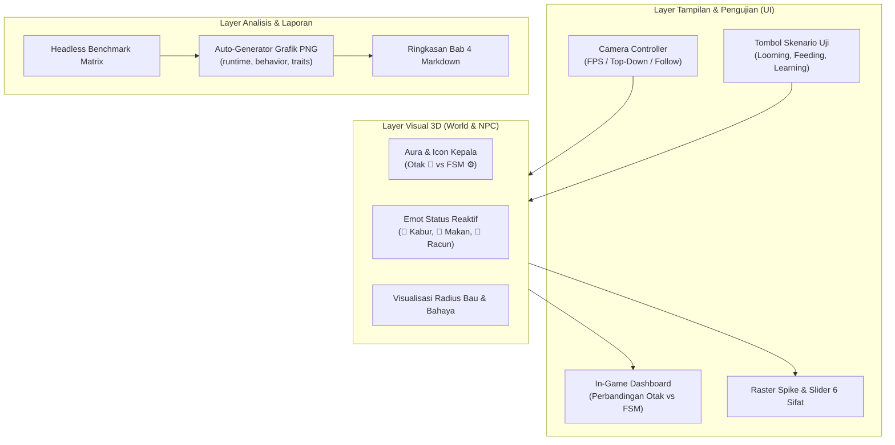

# Rencana Realisasi Pengujian Interaktif (Visual & Data) untuk Manusia

## Ringkasan Tujuan
Saat ini, ketika proyek dijalankan, pengguna hanya melihat tampilan first-person statis dengan overlay teks debug mentah (*FPS, instruksi tombol*), model NPC masih berupa kapsul polos tanpa pembeda visual yang kentara, dan belum ada skenario uji siap pakai atau dashboard data perbandingan langsung yang mudah dibaca oleh penguji/manusia.

Tujuan rencana ini adalah mengubah prototype simulasi menjadi **Sistem Pengujian Interaktif Ramah Pengguna (Human-in-the-Loop Evaluation Environment)** yang menyajikan:
1. **Hasil Visual yang Jelas**: Multi-kamera (FPS, Bird's-Eye Top-Down, Follow NPC), indikator status tingkah laku di atas kepala NPC (makan, kabur, keracunan, menjelajah), pembeda visual yang tegas antara NPC Otak vs FSM, serta tombol skenario uji instan.
2. **Hasil Data yang Lengkap**: Dashboard skor komparatif langsung di layar (Otak vs FSM) serta otomatisasi pembuatan grafik visual dan ringkasan statistik untuk Bab Hasil dan Pembahasan Tugas Akhir.

---

## User Review Required

> [!IMPORTANT]
> **1. Skema Kontrol Kamera Baru**
> Kami merencanakan penambahan tombol saklar kamera:
> - **F1**: Mode Karakter Pemain (First-Person, bisa berjalan dan lari mendekati NPC).
> - **F2**: Mode Pandangan Mata Burung (*Bird's-Eye / Top-Down View*), dapat melihat seluruh arena 40×40 m sekaligus untuk mengamati dinamika populasi.
> - **F3**: Mode *Follow NPC* (kamera otomatis mengikuti NPC yang sedang dipilih).
>
> **2. Penanda Visual Otak vs FSM**
> Agar manusia langsung mengenali metode yang mengendalikan NPC dari kejauhan:
> - NPC Otak: Diberi cincin aura/indikator ikon otak (🧠) atau cincin bercahaya biru/oranye.
> - NPC FSM: Diberi cincin aura/indikator ikon roda gigi (⚙️).
>
> **3. Skenario Uji Satu-Klik (Test Scenarios)**
> Daripada harus mengendalikan semuanya secara manual, kita tambahkan panel tombol pemicu skenario uji:
> - **Tes 1: Uji Reaksi Ancaman (*Looming Escape*)** &rarr; Memerintahkan predator menukik atau pemain lari mendekat untuk memverifikasi refleks Giant Fiber / DNp.
> - **Tes 2: Uji Pilihan Makanan (*Feeding Preference*)** &rarr; Menjatuhkan makanan manis & racun pahit berdampingan untuk melihat diskriminasi rasa.
> - **Tes 3: Uji Pembelajaran Bahaya (*Aversive Learning*)** &rarr; Menempatkan NPC di dekat zona bahaya untuk melihat penurunan waktu mendekat setelah tersengat.

---

## Open Questions

> [!NOTE]
> 1. Apakah Anda ingin data pengujian benchmark dijalankan dalam skala ringan ($N=10-24$ NPC) agar grafik langsung selesai dalam 1-2 menit, atau ingin matriks lengkap ($N=10, 50, 100, 200$) untuk data skripsi final?
> 2. Apakah Anda menginginkan file `.bat` satu-klik di desktop/folder proyek untuk menjalankan game dan mengekspor grafik secara otomatis?

---

## Proposed Changes



---

### Komponen 1: Visualisasi 3D & Kamera Pengamat

#### [MODIFY] [`scripts/World/Player.cs`](scripts/World/Player.cs)
- Tambahkan kemampuan perpindahan kamera bebas/top-down.
- Kursor mouse dapat digunakan untuk mengklik NPC atau menavigasi tanpa harus menahan klik kanan secara terus-menerus.
- Berikan crosshair atau pointer saat dalam mode FPS.

#### [MODIFY] [`scripts/Npc/NpcBase.cs`](scripts/Npc/NpcBase.cs)
- Tambahkan emot/ikon visual 3D di atas kepala yang berubah sesuai aktivitas:
  - 🏃💨 Saat *looming escape* aktif.
  - 🍎 Saat sedang mengonsumsi makanan manis.
  - 🤢 Saat mencicipi racun pahit.
  - ⚡ Saat berada di zona bahaya dan tersengat.
  - 🧭 Saat sedang menjelajah / eksplorasi.
- Tambahkan cincin penanda di bawah kaki NPC:
  - Cincin berputar hijau/oranye untuk NPC Otak.
  - Cincin abu-abu/biru untuk NPC FSM.

#### [MODIFY] [`scripts/World/Edible.cs`](scripts/World/Edible.cs) & [`scripts/World/DangerZone.cs`](scripts/World/DangerZone.cs)
- Tampilkan lingkaran transparan/radius aroma (*odor radius*) agar penguji dapat melihat jangkauan sensor penciuman NPC.

---

### Komponen 2: Panel Interaktif & Live Dashboard

#### [MODIFY] [`scripts/UI/DebugOverlay.cs`](scripts/UI/DebugOverlay.cs)
- Restrukturisasi UI menjadi rapi dan ramah pengguna:
  - **Header Navigasi**: Tab "Skenario Uji", "Statistik Komparatif", dan "Inspeksi Otak".
  - **Panel Skenario Cepat**: Tombol untuk memicu Looming Test, Feeding Test, dan Learning Test.
  - **Tabel Skor Langsung**: Menampilkan metrik rata-rata real-time antara grup Otak vs FSM:
    - Rata-rata Makanan Termakan (detik)
    - Persentase Berhasil Kabur dari Looming (%)
    - Jumlah Terkena Racun / Disengat Bahaya
    - Waktu Komputasi AI (ms/tick)

---

### Komponen 3: Otomatisasi Ekstraksi Data & Grafik Skripsi

#### [MODIFY] [`tools/analysis/run_benchmarks.py`](tools/analysis/run_benchmarks.py) & [`tools/analysis/analyze_bench.py`](tools/analysis/analyze_bench.py)
- Lengkapi eksekusi benchmark untuk kedua metode (Otak dan FSM).
- Hasilkan visualisasi grafik beresolusi tinggi di `reports/figures/`:
  1. `runtime.png`: Waktu komputasi CPU & Wall vs Jumlah NPC ($N$).
  2. `behavior.png`: Perbandingan kesuksesan makan, kabur, dan menghindari bahaya.
  3. `traits.png`: Perbedaan diferensiasi 4 tipe NPC (Rusa, Babi, Kucing, Penduduk).
  4. `turn_distribution.png`: Kealamian pola belok (variasi natural biologis).
  5. `trajectories.png`: Peta lintasan 2D eksplorasi arena.
- Siapkan skrip peluncur praktis `jalankan_pengujian.bat` agar pengguna bisa menjalankan simulasi dan melihat hasilnya tanpa repot mengetik perintah terminal.

---

## Verification Plan

### Automated Verification
1. Verifikasi kompilasi C#:
   ```powershell
   dotnet build otakLalat-npc.csproj -c Debug
   ```
2. Jalankan unit test sistem saraf:
   ```powershell
   dotnet test tests/BrainTests -c Release
   ```
3. Eksekusi pengolahan data benchmark:
   ```powershell
   .venv/Scripts/python.exe tools/analysis/analyze_bench.py
   ```

### Manual Verification oleh Pengguna
1. Jalankan aplikasi melalui shortcut atau editor Godot Mono.
2. Coba beralih antara kamera pemain (F1) dan pandangan atas (F2).
3. Tekan tombol skenario uji "Uji Looming" atau dekati NPC dengan Shift &rarr; amati emot panik/kabur muncul di atas kepala NPC.
4. Buka tab "Statistik Komparatif" di layar untuk melihat skor perbandingan langsung antara NPC Otak vs FSM.
5. Periksa gambar grafik yang dihasilkan di folder `reports/figures/` untuk memastikan data siap digunakan pada naskah Tugas Akhir.
